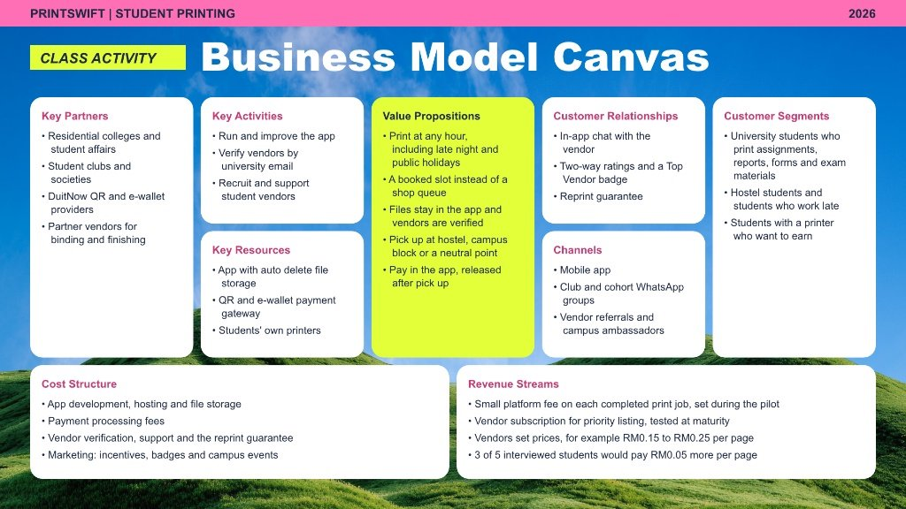

# PrintSwift | Peer-to-Peer Student Printing Network (UNIMAS 2026)

> **Class Activity: Business Model Canvas & Interactive Prototype**  
> **Institution:** Universiti Malaysia Sarawak (UNIMAS)  
> **Lead / Author:** Raynold Kabai (Matric: 100853) & Team  
> **Live Web App:** [https://iamraaaey.github.io/printswift/](https://iamraaaey.github.io/printswift/)

---

## 📌 Problem Statement & Campus Context

At Universiti Malaysia Sarawak (UNIMAS), students frequently face high-stakes deadlines for lab reports, final year project (FYP) submissions, scholarship documents, and tutorial sheets:
1. **Early Shop Closures:** Official campus printing centers (Student Pavilion, PeTARY Library) close by 5:00 PM and remain closed during weekends and public holidays.
2. **Panic Morning Queues:** Massive, stressful lines form between 7:30 AM and 8:00 AM before early morning lectures.
3. **Idle Hardware:** Many hostel residents in **Kolej Bunga Raya (KBR)**, **Kolej Tun Razak (KTR)**, and **Kolej Sakura (KSA)** own inkjet/EcoTank printers that sit unused 90% of the time.

**PrintSwift** bridges this gap as a student-to-student printing marketplace with scheduled pickup slots, DuitNow escrow payment protection, and an automated privacy auto-delete vault.

---

## 📊 Business Model Canvas (BMC 2026)



### The 9 Building Blocks:

1. **Value Propositions:**
   - **24/7 & Public Holiday Printing:** Late-night emergency printing right inside residential colleges.
   - **Booked Slots:** Guaranteed time slot pickup instead of standing in shop queues.
   - **Escrow-Secured Payments:** Payment held securely upfront; released to the student vendor only upon physical pickup confirmation.
   - **In-App Auto-Delete Privacy Vault:** Uploaded assignment files are permanently wiped from the vendor's device upon pickup.
   - **Flexible Pickup Points:** Hostel room doorstep, hostel block lobby, or campus neutral points (Pavilion / PeTARY).

2. **Customer Segments:**
   - UNIMAS students who regularly print assignments, lab reports, official forms, and exam materials.
   - Hostel students working late at night under tight deadlines.
   - Student printer owners who want to turn idle printer capacity into pocket money.

3. **Customer Relationships:**
   - Direct in-app chat with the assigned student vendor.
   - Two-way rating system (Student & Vendor ratings) with verified **Top Vendor** badges.
   - **PrintSwift Reprint Guarantee** protecting students against paper jams, ink smudges, or wrong duplex settings.

4. **Channels:**
   - Progressive Web Application (PWA / Mobile web).
   - Residential college & cohort WhatsApp/Telegram groups.
   - Campus brand ambassadors and peer vendor referrals.

5. **Revenue Streams:**
   - **RM0.20 Platform Escrow Fee** on every completed print job.
   - **Vendor Subscription / Priority Listing** tested at maturity for top-tier listings.
   - Student vendors set their own per-page rates (standard: **RM0.15 - RM0.25/page B&W**, **RM0.50/page Color**).
   - Validation survey: 3 out of 5 interviewed students agreed they would happily pay RM0.05 more per page for late-night speed and peace of mind.

6. **Key Activities:**
   - Platform maintenance, order routing, and real-time escrow management.
   - Verifying vendors via official `@siswa.unimas.my` university student credentials.
   - Onboarding and supporting student printer hosts across hostel colleges.

7. **Key Resources:**
   - In-app auto-delete file storage vault.
   - DuitNow QR & Touch 'n Go campus e-wallet escrow gateway.
   - Distributed network of student-owned EcoTank / InkJet printers.

8. **Key Partners:**
   - UNIMAS Residential Colleges (Kolej Bunga Raya, Kolej Tun Razak, Kolej Sakura, Kolej Cempaka, Kolej Dahlia) & Student Affairs (HEP).
   - Student clubs, academic societies, and faculty associations.
   - DuitNow QR and Malaysian e-wallet providers.
   - Partner vendors for comb binding, laminating, and hardcover finishing.

9. **Cost Structure:**
   - Application hosting, domain, and secure temporary cloud storage.
   - DuitNow payment processing fees.
   - Vendor onboarding verification and the **Reprint Guarantee** escrow buffer.
   - Campus marketing, ambassador incentives, and trust badge rewards.

---

## 🚀 Key Prototype Features

- 📱 **Full Mobile App Frame & Desktop Presentation Mode:** Realistic smartphone frame with interactive device toggles for desktop presentations.
- 🔄 **Two-Way Role Switcher:** Toggle instantly between **Student Mode** and **Vendor Portal** from the top bar.
- 📄 **Real File Upload & Document Estimator:** Upload PDFs, Word documents, or slides with automatic page count detection and customizable print specs.
- 💳 **DuitNow Escrow Checkout:** Real Malaysian DuitNow QR generation and Campus E-Wallet top-up simulator.
- 🔒 **Privacy Auto-Delete Verification:** Simulated secure viewer and automatic file wipe once handover is confirmed.
- 🛡️ **PrintSwift Reprint Guarantee:** Interactive claim flow allowing students to report smudged pages or wrong settings, freezing escrow funds until resolved.
- 💬 **Live In-App Chat:** Instant messaging with student vendors for pickup coordination.
- 💾 **Persistent State:** Saves wallet balances, order statuses, custom vendor slots, and ratings in `localStorage`.
- 🎵 **Web Audio Synthesizer:** Real-time sound effects for taps, print feedback, and success dings.

---

## 🛠️ Local Development & Running

Run locally with any static web server:

```bash
# Clone the repository
git clone https://github.com/iamraaaey/printswift.git
cd printswift

# Run using npx serve or python
npx serve -s . -l 3000
# or
python -m http.server 3000
```

Open your browser at `http://localhost:3000`.

---

## 🌐 Deployment to GitHub Pages

This project is deployed to GitHub Pages via GitHub Actions (`.github/workflows/deploy.yml`):
- **Live URL:** [https://iamraaaey.github.io/printswift/](https://iamraaaey.github.io/printswift/)

---

© 2026 PrintSwift UNIMAS • Built for Class Activity by Raynold Kabai (Matric: 100853).
